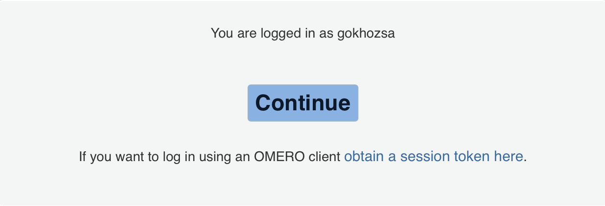

# omero-transfer

Copy an image, dataset or project from one OMERO server to another.

The copy happens in two stages. First the data is **packed**: everything is downloaded from the
first server into a single file on your computer, called the **archive**. Then it is **unpacked**:
the archive is uploaded to the second server, which rebuilds the same structure there.

```
source server  ->  archive on your computer  ->  target server
```

The scripts in this repo do both stages for you, using
[omero-cli-transfer](https://github.com/ome/omero-cli-transfer). You fill in one small settings
file and run one command.

## Before you start

Check all of these before your first transfer.

- **uv is installed.** This is the tool that installs everything else. Run `uv --version` to check.
  If it is missing, install it with:

  ```bash
  curl -LsSf https://astral.sh/uv/install.sh | sh
  ```

- **You have an account on both servers.** The usernames can be different on each side.
- **The group already exists on the target server,** and you are a member of it. A group is the
  OMERO workspace that owns the data. The transfer will not create one for you.
- **You have enough free disk space** for the archive, roughly the same size as the data you are
  copying.
- **You know what you want to copy.** You need its type (Image, Dataset or Project) and its ID
  number. In OMERO.web, click the item and the ID is shown in the right-hand panel, for example
  `Dataset:1`.

This works on macOS and on Linux x86_64. For anything else, see
[Other platforms](#other-platforms).

## Step by step

### Step 1: Install (first time only)

From the repo folder, run:

```bash
uv sync
```

This downloads Python and the OMERO tools into a `.venv` folder inside the repo. It takes a minute
or two the first time and is instant afterwards. You never need to "activate" anything; the
scripts handle that themselves.

### Step 2: Write your settings file

Make your own copy of the template:

```bash
cp transfer.env.example transfer.env
```

Open `transfer.env` in a text editor and replace every value written inside angle brackets. A
finished file looks like this:

```bash
SRC=omero-staging.c3se.chalmers.se       # server you copy FROM
DST=omero.scilifelab.se                  # server you copy TO
SRC_USER=gokhozsa                        # your username on the source server
SRC_PASSWORD=                            # optional; if empty, omero login prompts interactively
SRC_GROUP=omero_test_20                  # group that owns the data on the source server
DST_USER=gokhozsa                        # your username on the target server
DST_PASSWORD=                            # optional; if empty, omero login prompts interactively
DST_GROUP=omero_test_20                  # group to copy into on the target server
OBJ=Dataset:1                            # what to copy
ARCHIVE=~/omero-transfers/dataset1.zip   # where to put the archive on your computer
MERGE=false
```

Two notes on this file:

- Leave the two password lines empty. See [Passwords](#passwords) for why.
- `transfer.env` is never committed to git, so your details stay on your machine.
- If a later unpack finishes without copying any images, the target server needs `ssl://` in
  front of its name. See [Nothing was imported](#nothing-was-imported).

### Step 3: Check that everything is ready

```bash
scripts/check.sh
```

This confirms your settings are filled in, that both servers answer, and that you have disk space.
It changes nothing. The last line should read:

```
==> All checks passed
```

If it does not, read the warning it printed and see [Troubleshooting](#troubleshooting).

### Step 4: Run the transfer

```bash
scripts/transfer.sh
```

Unless you filled in the password fields, you will be asked for your password twice, once per
server, and nothing is shown as you type. See [Passwords](#passwords). The script then packs the
data, uploads it, and prints a summary.

Packing downloads every original file, so a large project can take a long time. Leave the terminal
window open until it finishes.

### Step 5: Check the result, then clean up

At the end the script pauses and asks whether to delete the archive. Before answering, open the
target server in OMERO.web and confirm:

1. The project or dataset is there, with the right number of images and visible thumbnails.
2. A few images still have their tags, key-value pairs, attachments, ratings and ROIs.

Once you are satisfied, answer `y` to delete the archive from your computer. If anything looks
wrong, answer `n`: the archive is kept so you can unpack it again without repeating the download.

## Choosing what to transfer

The `OBJ` setting says what gets copied. Everything inside it comes along.

```bash
OBJ=Image:19          # one image
OBJ=Dataset:1         # a dataset, with all its images
OBJ=Project:1         # a project, with all its datasets
OBJ=Image:19-25       # images 19 to 25
OBJ=Dataset:1,4,7     # datasets 1, 4 and 7
```

`Plate` and `Screen` also work, but most servers block them until an administrator changes a
setting. See [Troubleshooting](#troubleshooting).

## Passwords

`SRC_PASSWORD` and `DST_PASSWORD` are optional. If empty, the scripts will then ask you for each password
when they need it, which is the safest option. If you put passwords in the settings file, be aware of what that
means: the file stores them as ordinary readable text, and while the transfer runs, anyone else
with an account on the same machine can see them in the list of running processes.

## Single sign-on

If you sign in to OMERO.web through your institution (single sign-on), you probably have no
password that works outside the browser. Instead, OMERO.web can give you a **session token**: a
code that stands in for your login. After signing in, follow the "obtain a session token here"
link.



A token is used as both the username and the password for that server. Put the same value in
both fields:

```bash
DST_USER=9b3c7e05-...
DST_PASSWORD=9b3c7e05-...
```

The two servers are independent, so you can use a token on one side and an ordinary username and
password on the other.

A few things worth knowing:

- **Your group still applies.** `SRC_GROUP` and `DST_GROUP` work exactly as they do for an
  ordinary login; a token changes nothing about them.
- **Tokens expire.** A stale one is rejected like a wrong password; get a fresh one from the
  same link.
- **The token is not printed.** The scripts show `(session token)` instead, so it does not end up
  in your terminal history or in a log you paste to someone.

## Common tasks

**Add to a dataset that already exists on the target.** By default a second dataset with the same
name is created. To put the images into the existing one instead:

```bash
scripts/transfer.sh --merge
```

**Keep settings for several different transfers.** Put each one in the `configs/` folder and
choose it with `-c`:

```bash
cp configs/staging-to-prod.env.example configs/staging-to-prod.env
scripts/transfer.sh -c configs/staging-to-prod.env
```

**Change one setting for a single run,** without editing the file:

```bash
OBJ=Dataset:4 scripts/transfer.sh
```

**Pack and unpack on different computers.** Useful when no single machine can reach both servers.
Run the first half where the source is reachable, copy the archive across, then run the second
half:

```bash
scripts/pack.sh        # on the machine that can reach the source
scripts/unpack.sh      # on the machine that can reach the target
```

## What is and is not copied

**Copied:** images and their original files, the project and dataset structure, tags, key-value
pairs, file attachments, ratings, comments, and ROIs.

**Not copied:** Mask ROIs, rendering settings (brightness, contrast and channel colours), and any
annotation type not listed above.

## Troubleshooting

**The check or a login fails with a connection error.** The server name may be wrong, or the
server may not be reachable from your network. Run `scripts/check.sh` to see which of the two
servers is unreachable.

**You see `SecurityViolation`, or an error about the group, when unpacking.** You are not a member
of `DST_GROUP` on the target server, or the group is named differently there. The two groups are
set independently, so `SRC_GROUP` and `DST_GROUP` do not have to match.

**The data arrives in the wrong group.** OMERO falls back to your default group without
complaining when you ask for one you are not a member of. Check `DST_GROUP` against the group
list in OMERO.web on the target server.

**Your login is rejected and you use single sign-on.** The session token has expired or was
copied incompletely, and it fails the same way a wrong password would. Get a fresh one from
OMERO.web, as described in [Single sign-on](#single-sign-on).

**You see `'transfer' is not a recognized command`.** The tools are not installed. Run `uv sync`
in the repo folder, and start the scripts from there.

**`uv sync` starts compiling `zeroc-ice` and fails.** There is no prepared package for your
computer. See [Other platforms](#other-platforms).

**Packing a Plate or Screen fails to download.** OMERO blocks these downloads by default. A server
administrator has to relax the `omero.policy.binary_access` setting before this can work.

<a id="nothing-was-imported"></a>
**Unpacking finishes but no images arrive.** Look in the output for `Insecure connection
requested, falling back`, then `Obtained null object proxy`, and finally `Image corresponding to
Image:1 not found. Skipping.` The image importer first connects to the server encrypted, then
tries to switch to an unencrypted connection for the upload, and that second connection is
blocked on many servers. Keep it encrypted by putting `ssl://` in front of that server name:

```bash
DST=ssl://omero.scilifelab.se
```

Then unpack again. The archive from the earlier attempt can be reused; there is no need to pack a
second time. Delete any empty projects or datasets the failed attempt left behind first.

**A second attempt at unpacking creates duplicates, or fails with a `clientPath` error.** A
previous failed attempt left images behind on the target. Delete those partial imports in
OMERO.web first, then unpack again.

## Reference

### Settings

| Setting | Meaning |
| --- | --- |
| `SRC` / `DST` | Server to copy from / to. May carry an `ssl://` prefix, see [Nothing was imported](#nothing-was-imported) |
| `SRC_USER` / `DST_USER` | Your username on each server |
| `SRC_PASSWORD` / `DST_PASSWORD` | Optional; if empty you are asked when needed |
| `SRC_GROUP` / `DST_GROUP` | Group on each server. Both required, and they may be named differently |
| `OBJ` | What to copy, for example `Dataset:1` |
| `ARCHIVE` | Where to write the archive; `.zip` compresses, `.tar` makes a tarball, a name with no extension writes a folder |
| `MERGE` | `true` adds to an existing project or dataset of the same name |
| `PORT` | Only if the server does not use the standard 4064. Ignored for an `ssl://` host, which carries its own port |

Settings given on the command line override the file.

### Scripts

| Script | What it does |
| --- | --- |
| `scripts/check.sh` | Checks the settings, both servers and disk space. Changes nothing |
| `scripts/pack.sh` | Downloads the data from the source into the archive |
| `scripts/unpack.sh` | Uploads the archive to the target |
| `scripts/transfer.sh` | All three in order, then offers to delete the archive |

Every script accepts `-c FILE` to use a different settings file and `-h` for help.
`unpack.sh` and `transfer.sh` also accept `--merge`.

### Running the OMERO CLI by hand

The full `omero` command line is available through `uv run`:

```bash
uv run omero login -u gokhozsa -s omero-staging.c3se.chalmers.se -g omero_test_20
uv run omero transfer pack Dataset:1 ~/omero-transfers/dataset1.zip
uv run omero logout
```

## For maintainers

### Other platforms

`omero-py` needs `zeroc-ice` 3.6.5, which does not build reliably from source, so
[pyproject.toml](pyproject.toml) pins prebuilt Glencoe Software wheels for Python 3.12 under
`[tool.uv.sources]`. For another platform or a newer build, add or change the URL there using the
[macOS releases](https://github.com/glencoesoftware/zeroc-ice-py-macos-universal2/releases) or
[Linux releases](https://github.com/glencoesoftware/zeroc-ice-py-linux-x86_64/releases), keeping
the `cp312` tag in line with `requires-python`, then run `uv lock`.

### Checking the scripts

```bash
uv run --group dev shellcheck scripts/*.sh
```
