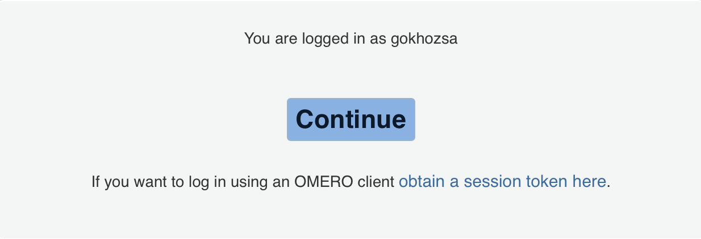

# Passwords and single sign-on

How to tell the scripts who you are on each server. The two servers are independent, so you can
use an ordinary password on one side and a single sign-on token on the other.

## Passwords

`SRC_PASSWORD` and `DST_PASSWORD` are optional. If empty, the scripts will then ask you for each password
when they need it, which is the safest option. If you put passwords in the settings file, be aware of what that
means: the file stores them as ordinary readable text, and while the transfer runs, anyone else
with an account on the same machine can see them in the list of running processes.

If a server refuses the login, the script asks again for **both** the username and the password,
up to three attempts. A refused login is as often a wrong username as a wrong password, so both
are offered. Nothing you type at the prompt is written back to the settings file; correct the
file yourself to stop it being asked again on the next run.

## Single sign-on

If you sign in to OMERO.web through your institution (single sign-on), you probably have no
password that works outside the browser. Instead, OMERO.web can give you a **session token**: a
code that stands in for your login. After signing in, follow the "obtain a session token here"
link.



A token is used as both the username and the password for that server. Put the same value in
both fields:

```bash
DST_USER=9b3c7e05-...
DST_PASSWORD=9b3c7e05-...
```

The two servers are independent, so you can use a token on one side and an ordinary username and
password on the other.

A few things worth knowing:

- **Your group still applies.** `SRC_GROUP` and `DST_GROUP` work exactly as they do for an
  ordinary login; a token changes nothing about them.
- **Tokens expire.** A stale one is rejected like a wrong password; get a fresh one from the
  same link.
- **The token is not printed.** The scripts show `(session token)` instead, so it does not end up
  in your terminal history or in a log you paste to someone.
